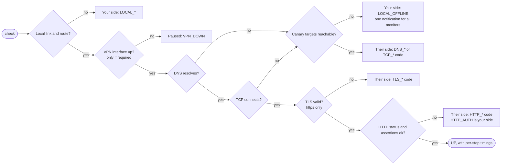
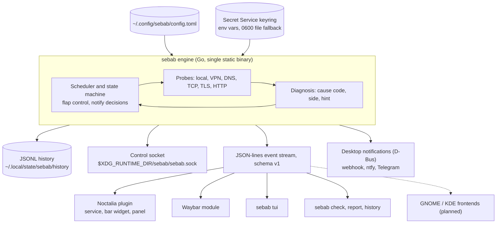

<a id="top"></a>

<p align="center">
  <h1 align="center">Sebab</h1>
  <p align="center"><b>Find out WHY a service is down, not just that it is.</b></p>
  <p align="center">
    Sebab (Indonesian for "cause") is a local endpoint monitor for Linux desktops. A small Go engine checks your
    HTTP(S) and TCP endpoints layer by layer, names the layer that failed and tells you whether the fault is on
    your side or theirs. Results land in your bar, your notifications and your terminal.
  </p>
</p>

<p align="center">
  <a href="https://github.com/yoockh/Sebab/actions/workflows/ci.yml"></a>
  
  <a href="LICENSE"></a>
</p>
<p align="center">
  
  
  
  
</p>
<p align="center">
  
  
  
  
</p>

<a id="screenshots"></a>

## Screenshots

<!-- A human must add real screenshots: docs/img/panel.png (Noctalia panel) and docs/img/tui.png (sebab tui).
     They are intentionally not generated. Until then the images below do not render. -->

| Noctalia panel | Terminal UI |
|---|---|
|  |  |
| Overview card, 24 h status strips, latency sparklines and the result card of a live test. | `sebab tui`: every monitor, its cause and a latency sparkline in a terminal. |

<a id="contents"></a>

## Table of contents

- [Why Sebab](#why-sebab)
- [How it works](#how-it-works)
- [Features](#features)
- [Installation](#installation)
- [Quick start](#quick-start)
- [Usage reference](#usage-reference)
- [Configuration](#configuration)
- [Failure lab](#failure-lab)
- [Roadmap](#roadmap)
- [Project layout](#project-layout)
- [Contributing](#contributing)
- [License, acknowledgements and security](#license)

<a id="why-sebab"></a>

## Why Sebab

- **The problem:** a ping widget turns red and says "down". It cannot tell an expired certificate from a dead
  upstream behind a gateway, a missing DNS record, a rejected token or your own Wi-Fi dropping. You open a terminal
  and run `curl -v`, `dig` and `openssl s_client` by hand.
- **The answer:** Sebab checks the real service (HTTP or TCP, not ICMP) one layer at a time and stops at the first
  failure: *"Payments API is down: TLS certificate expired 2 days ago. DNS and TCP are fine."* When your own
  connection is the problem you get one "You are offline" message instead of an alert storm.
- **Who it is for:** QA engineers and developers who depend on staging, production and third-party APIs, and anyone
  whose internal tools only work behind a VPN.

<p align="right"><a href="#top">Back to top</a></p>

<a id="how-it-works"></a>

## How it works

### Layered diagnosis



Every check records per-step timings (DNS, TCP, TLS, time to first byte, total). After a failure the engine checks
a canary (default `tcp://1.1.1.1:443` and `tcp://9.9.9.9:443`, configurable or disabled) to decide whose side it is.

### Architecture



One engine serves every frontend: `sebab daemon` (systemd user service) or the engine started by the first
frontend serves the socket, and later frontends attach to it, so nothing is probed twice.

### Cause codes

The full list, straight from `internal/diagnose/codes.go`:

| Layer | Code | Meaning | Status | Side |
|---|---|---|---|---|
| local | `LOCAL_NO_LINK` | No active network interface | unknown | yours |
| local | `LOCAL_NO_ROUTE` | No default route | unknown | yours |
| local | `LOCAL_OFFLINE` | Canary unreachable | unknown | yours |
| local | `LOCAL_DNS_BROKEN` | Resolver fails for canary names too | unknown | yours |
| vpn | `VPN_DOWN` | Required VPN interface missing or down | paused | yours |
| dns | `DNS_NXDOMAIN` | Name does not exist | down | theirs |
| dns | `DNS_SERVFAIL` | Authoritative or resolver failure | down | theirs |
| dns | `DNS_TIMEOUT` | No DNS answer in time | down | unknown |
| dns | `DNS_NO_ADDRESS` | Name exists but has no A/AAAA record | down | theirs |
| tcp | `TCP_REFUSED` | Host reachable, nothing listening on the port | down | theirs |
| tcp | `TCP_TIMEOUT` | No answer, host down or filtered | down | theirs |
| tcp | `TCP_UNREACHABLE` | Network or host unreachable | down | unknown |
| tls | `TLS_EXPIRED` | Certificate expired | down | theirs |
| tls | `TLS_NOT_YET_VALID` | Certificate not yet valid (check local clock) | down | unknown |
| tls | `TLS_HOSTNAME_MISMATCH` | Certificate does not cover the hostname | down | theirs |
| tls | `TLS_UNTRUSTED` | Unknown CA or self-signed | down | theirs |
| tls | `TLS_HANDSHAKE_FAILED` | Protocol or cipher failure | down | theirs |
| tls | `TLS_EXPIRING_SOON` | Certificate expires soon | degraded | theirs |
| http | `HTTP_BAD_GATEWAY` | 502 or 504 from a proxy, upstream likely down | down | theirs |
| http | `HTTP_UNAVAILABLE` | 503, overloaded or maintenance | down | theirs |
| http | `HTTP_SERVER_ERROR` | Other 5xx | down | theirs |
| http | `HTTP_AUTH` | 401 or 403, credentials rejected | down | yours |
| http | `HTTP_CLIENT_ERROR` | Other unexpected 4xx | down | theirs |
| http | `HTTP_RATE_LIMITED` | 429 rate limited | degraded | theirs |
| http | `HTTP_TIMEOUT` | Connected, but no response in time | down | theirs |
| http | `HTTP_SLOW` | Response above latency threshold | degraded | theirs |
| http | `HTTP_UNEXPECTED_STATUS` | Status not in `expect_status` | down | theirs |
| http | `HTTP_UNEXPECTED_REDIRECT` | Redirected to an unexpected host | down | theirs |
| http | `HTTP_REDIRECT_LOOP` | More than 10 redirects | down | theirs |
| http | `HTTP_ASSERTION_FAILED` | Response content assertion failed | down | theirs |

DNS and TCP sides switch to `unknown` when the canary is disabled, and `DNS_TIMEOUT`/`DNS_SERVFAIL` become
"theirs" once other names resolve. Event format and socket protocol: [docs/event-schema.md](docs/event-schema.md).

<p align="right"><a href="#top">Back to top</a></p>

<a id="features"></a>

## Features

| Feature | What it does | Status |
|---|---|---|
| Layered probes | Local, VPN, DNS, TCP, TLS, HTTP in order, with per-step timings | stable |
| Cause codes and side | 30 codes, plain-language summary and hint, your side vs their side via a canary | stable |
| One-shot check | `sebab check` with readable output, `--json` and per-layer exit codes | stable |
| Flap control | Alert after N failures, recover after M successes, one notification per incident | stable |
| Offline handling | One "You are offline" and one "Back online" instead of an alert storm | stable |
| VPN preconditions | Monitors needing `wg0` pause with `VPN_DOWN` while it is down | stable |
| Authenticated checks | Bearer, custom header, basic auth; secrets in the keyring, never in config or events | stable |
| TLS expiry warning | Degraded within `tls_warn_days` (default 14), at most one notification a day | stable |
| Assertions | JSON path, body text and header checks (also catches captive portals) | beta |
| Noctalia plugin | Bar widget, panel with dashboard, live test before save, help view | beta |
| Waybar module | `sebab waybar` prints custom-module JSON | beta |
| Terminal UI | `sebab tui` | beta |
| Daemon and socket | One shared engine for all frontends, systemd user unit, logind suspend handling | beta |
| History and reports | JSONL history, `sebab history`, `sebab overview`, Markdown incident reports | beta |
| Quiet hours and mute | Suppress notifications in a time window or per monitor | beta |
| External channels | Webhook, ntfy and Telegram notifications | beta |
| Packages | AUR PKGBUILDs, `.deb` and `.rpm` via nfpm and goreleaser | planned (built locally, not published) |
| "Down for everyone?" | Opt-in Globalping check | planned |
| GNOME and KDE frontends | Same event stream, other desktops | planned |

<p align="right"><a href="#top">Back to top</a></p>

<a id="installation"></a>

## Installation

### Arch Linux

PKGBUILDs for `sebab-bin` and `sebab-git` live in [packaging/aur](packaging/aur). They are not on the AUR yet;
until they are, build the git package from the GitHub repository:

```sh
git clone https://github.com/yoockh/Sebab.git
cd Sebab/packaging/aur/sebab-git && makepkg -si
```

### Build from source

Requirements: Go 1.26 or newer, `git`, `make`. Optional: `luau` (plugin tests), `docker` (container lab).

```sh
make build        # bin/sebab (static, CGO_ENABLED=0)
make lab          # bin/sebab-lab, the failure lab
make check        # gofmt, go vet, go test -race ./...
```

### Noctalia plugin

The plugin lives in [frontends/noctalia/sebab](frontends/noctalia/sebab). Until it is in the community catalog,
add the directory that contains it as a path source:

```sh
noctalia msg plugins source add dev path /path/to/Sebab/frontends/noctalia
noctalia msg plugins enable yoockh/sebab
```

Then add the "Sebab" widget to a bar (Settings, Bar). The plugin needs `sebab` on `PATH` (or set its `binary`
setting).

<details>
<summary>Debian, Ubuntu, Fedora (planned)</summary>

`.deb` and `.rpm` packages are defined in [packaging/nfpm/nfpm.yaml](packaging/nfpm/nfpm.yaml) and in
[.goreleaser.yaml](.goreleaser.yaml). They build and install cleanly in Debian 12, Ubuntu 24.04 and Fedora 42
containers, but no release is published yet. Until then, build from source.

</details>

<p align="right"><a href="#top">Back to top</a></p>

<a id="quick-start"></a>

## Quick start

**From the panel:** open it from the widget, press **+**, enter a name and a URL (or `host:port`), press
**Test, then save** to see which layer answers, then **Save**.

**From the CLI:**

```sh
sebab doctor                                                     # what is missing on this machine
sebab monitor add --name "Payments API" --target https://api.example.com/health
sebab monitor list
sebab watch                                                      # live JSON event stream
```

**One-shot check** (real output, captured against the [failure lab](#failure-lab)):

```text
$ sebab check --ca-file lab/out/ca.pem https://app.lab.test:18082/ok
https://app.lab.test:18082/ok
  [ ok ] local link up, route ok
  [ ok ] dns   0 ms
  [ ok ] tcp   0 ms 127.0.0.1:18082 (ipv4)
  [FAIL] tls   TLS certificate expired 2 days ago
DOWN  TLS_EXPIRED  (side: theirs)
Hint: Renew the certificate on the server. DNS and TCP are fine.
total 2 ms
$ echo $?
14
```

Read it top to bottom: every `ok` layer passed, the `FAIL` line names the layer and the cause, the side says whose
problem it is, and the exit code identifies the layer (0 up, 1 degraded, 10 local, 11 VPN, 12 DNS, 13 TCP,
14 TLS, 15 HTTP; see [docs/cli.md](docs/cli.md)).

<p align="right"><a href="#top">Back to top</a></p>

<a id="usage-reference"></a>

## Usage reference

| Command | What it does |
|---|---|
| `sebab check <url or host:port>` | Check once and explain any failure (`--json`, `--markdown`, `--monitor ID`) |
| `sebab monitor add, list, show, edit, rm, pause, resume, mute, unmute` | Manage monitors in `config.toml` |
| `sebab watch` | Stream engine events as JSON lines; attaches to a running engine |
| `sebab daemon` | Run the shared engine in the background (systemd user service) |
| `sebab secret set, rm, list, handoff` | Manage secrets; values only via stdin or a handoff file |
| `sebab doctor` | Explain what is missing (keyring, notifications, network, engine) |
| `sebab report <id>` | Redacted Markdown diagnosis with the last 24 h of status changes |
| `sebab history [id]` | Availability, latency percentiles and status changes from local history |
| `sebab overview` | 24 h uptime, status strips and incidents as JSON (dashboards) |
| `sebab tui` | Interactive terminal view |
| `sebab waybar` | Waybar custom-module JSON |
| `sebab refresh [id]` | Ask the running engine to check now |
| `sebab notify-test` | Send a test notification to the desktop and every channel |

Every command has `-h`; details in [docs/cli.md](docs/cli.md).

**Waybar** (minimal snippet; [frontends/waybar](frontends/waybar) has the full example with per-state icons and CSS):

```jsonc
"custom/sebab": {
  "exec": "sebab waybar",
  "return-type": "json",
  "restart-interval": 5,
  "exec-on-event": false,
  "format": "{text}",
  "on-click": "sebab refresh"
}
```

<p align="right"><a href="#top">Back to top</a></p>

<a id="configuration"></a>

## Configuration

`~/.config/sebab/config.toml` is the single source of truth for every frontend. Full reference:
[docs/config.md](docs/config.md).

```toml
[defaults]
interval = "60s"            # minimum 30s
fail_threshold = 2          # failures before "down" is notified
recover_threshold = 2       # successes before "recovered"
canary = ["tcp://1.1.1.1:443", "tcp://9.9.9.9:443"]   # [] disables side detection
quiet_hours = "22:00-07:00" # no notifications in this window (local time)

[[monitor]]
id = "payments-api"
name = "Payments API"
url = "https://api.example.com/health"
expect_status = [200]
auth = { type = "bearer", secret = "payments-token" }   # a reference, never the token
requires_vpn = { interface = "wg0" }                    # pause while wg0 is down

[[monitor]]
id = "staging-db"
name = "Staging DB"
target = "tcp://db.staging.example:5432"
```

| Where | What |
|---|---|
| Secret Service keyring | Preferred home for tokens (`sebab secret set NAME`, value on stdin) |
| `env:NAME` references | `secret = "env:API_TOKEN"` reads the engine's environment |
| `~/.config/sebab/secrets.toml` | Fallback when no keyring runs; mode 0600, refused if readable by others, with a warning |
| `~/.config/sebab/config.toml` | Written atomically with mode 0600; the previous version is kept as `config.toml.bak` |
| `$XDG_RUNTIME_DIR/sebab/sebab.sock` | Control socket, 0600 in a 0700 directory, peer uid checked |
| `~/.local/state/sebab/history/` | JSONL check history (default 7 days) |

<p align="right"><a href="#top">Back to top</a></p>

<a id="failure-lab"></a>

## Failure lab

Pure-Go servers on loopback reproduce every failure mode; nothing touches the internet. The same lab backs one
integration test per cause code (`go test ./lab`).

```sh
make lab
./bin/sebab-lab -out lab/out
export SEBAB_LAB_DNS=127.0.0.1:15353 SEBAB_CONFIG=$PWD/lab/out/config.toml
./bin/sebab watch --embedded
```

| Scenario | Lab monitor | Expected code |
|---|---|---|
| Missing name | `nxdomain` | `DNS_NXDOMAIN` |
| Broken DNS, no answer, no records | `servfail`, `dns-timeout`, `noaddr` | `DNS_SERVFAIL`, `DNS_TIMEOUT`, `DNS_NO_ADDRESS` |
| Closed port, blackholed TEST-NET address | `refused`, `blackhole` | `TCP_REFUSED`, `TCP_TIMEOUT` |
| Expired, future, wrong-host, self-signed cert | `expired`, `notyet`, `wronghost`, `selfsigned` | `TLS_EXPIRED`, `TLS_NOT_YET_VALID`, `TLS_HOSTNAME_MISMATCH`, `TLS_UNTRUSTED` |
| Expiring cert, non-TLS server | `expiring`, `handshake` | `TLS_EXPIRING_SOON`, `TLS_HANDSHAKE_FAILED` |
| 401, 502, 503, 500, 404, 429 | `http-401` to `http-429` | `HTTP_AUTH`, `HTTP_BAD_GATEWAY`, `HTTP_UNAVAILABLE`, `HTTP_SERVER_ERROR`, `HTTP_CLIENT_ERROR`, `HTTP_RATE_LIMITED` |
| Slow, hanging response | `slow`, `hang` | `HTTP_SLOW`, `HTTP_TIMEOUT` |
| Wrong status, redirects | `wrong-status`, `redirect-away`, `redirect-loop` | `HTTP_UNEXPECTED_STATUS`, `HTTP_UNEXPECTED_REDIRECT`, `HTTP_REDIRECT_LOOP` |
| Captive portal | `captive` | `HTTP_ASSERTION_FAILED` |
| Missing VPN | `vpn` | `VPN_DOWN` |

An optional container variant lives in [lab/docker-compose.yml](lab/docker-compose.yml). The full manual checklist
is in [TESTING.md](TESTING.md).

<p align="right"><a href="#top">Back to top</a></p>

<a id="roadmap"></a>

## Roadmap

**Phase 0, foundations**
- [x] Go module, CI, event schema v1 with golden tests
- [x] `sebab watch` streaming into a Noctalia widget

**Phase 1, MVP on Arch and Noctalia**
- [x] Layered probes, cause codes, canary side detection, flap control
- [x] Authenticated checks with keyring storage and redaction tests
- [x] VPN preconditions, TLS expiry warnings, `sebab check`, `sebab doctor`
- [x] Failure lab with one integration test per cause code
- [x] Noctalia plugin: service, bar widget, panel
- [ ] AUR packages published from a signed release

**Phase 2, daemon, Waybar, more distributions**
- [x] `sebab daemon`, control socket, systemd user unit, logind suspend handling
- [x] Waybar module, D-Bus notifications without duplicates
- [x] `.deb` and `.rpm` definitions (built and install-tested in containers)
- [ ] Published packages and a community catalog listing for the plugin

**Phase 3, depth for QA work**
- [x] History, sparklines, overview dashboard, Markdown incident reports
- [x] Assertions, quiet hours, per-monitor mute
- [x] Webhook, ntfy and Telegram channels
- [ ] Opt-in "is it down for everyone" check (Globalping)

**Phase 4, more frontends**
- [x] `sebab tui`
- [ ] GNOME Shell extension and KDE Plasma widget

**Phase 5, toward 1.0**
- [x] Security review of secret handling, reproducible builds ([docs/security.md](docs/security.md))
- [ ] Frozen schemas with migrations, documentation site, translations, signed 1.0 release

<p align="right"><a href="#top">Back to top</a></p>

<a id="project-layout"></a>

## Project layout

```text
cmd/sebab/              CLI entry point
internal/
  engine/               scheduler, state machine, flap control, notification decisions
  probe/                local, VPN, DNS, TCP, TLS and HTTP probes, canary, assertions
  diagnose/             cause codes, summaries, hints, side decision
  config/               config.toml schema, validation, atomic writes
  event/                event schema v1 and JSON-lines encoder
  secret/               keyring, env and file stores, handoff files, redaction
  server/               control socket, subscriptions
  history/              JSONL history and dashboard overview
  cli/                  every sebab command
  platform/linux/       netlink, procfs routes, D-Bus notifications, logind
  channels/             webhook, ntfy, Telegram
  tui/ waybar/ report/  terminal UI, Waybar output, Markdown reports
frontends/
  noctalia/sebab/       Noctalia plugin (Luau): service, widget, panel, translations
  waybar/               example Waybar config and CSS
lab/                    failure lab servers, integration tests, sebab-lab, docker-compose
packaging/              aur/, nfpm/, systemd/
docs/                   CLI, config, event schema and security documentation
```

<p align="right"><a href="#top">Back to top</a></p>

<a id="contributing"></a>

## Contributing

- Commits follow [Conventional Commits](https://www.conventionalcommits.org/) (`feat(panel): ...`,
  `fix(save): ...`, `docs: ...`), one commit per change.
- Before committing: `make check` (gofmt, vet, `go test -race ./...`) and `make plugin-test` (plugin scripts in a
  real Luau VM; needs `luau` on `PATH` or `SEBAB_LUAU`).
- Every feature ships with tests; secret handling changes need a leak test.
- Manual test steps: [TESTING.md](TESTING.md). Design decisions and their reasons: [DECISIONS.md](DECISIONS.md).
  Progress per story: [PROGRESS.md](PROGRESS.md).

<p align="right"><a href="#top">Back to top</a></p>

<a id="license"></a>

## License, acknowledgements and security

**License:** MIT, see [LICENSE](LICENSE).

**Acknowledgements:** [Noctalia](https://github.com/noctalia-dev/noctalia) for the shell and its plugin API,
[Waybar](https://github.com/Alexays/Waybar), [Luau](https://luau.org) and [Go](https://go.dev).

**Security:** no telemetry. Secrets live in the Secret Service keyring (or an env var, or a 0600 fallback file),
`config.toml` only holds references, and secrets are never accepted as command-line arguments. Every event,
notification, report and error passes a redactor, and automated tests grep all outputs for a canary secret. The
Noctalia panel hands tokens over in a one-shot 0600 file that the engine deletes, and wipes them when the panel
closes. Details: [docs/security.md](docs/security.md).

<p align="right"><a href="#top">Back to top</a></p>
